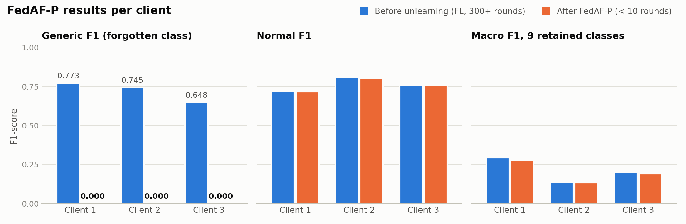
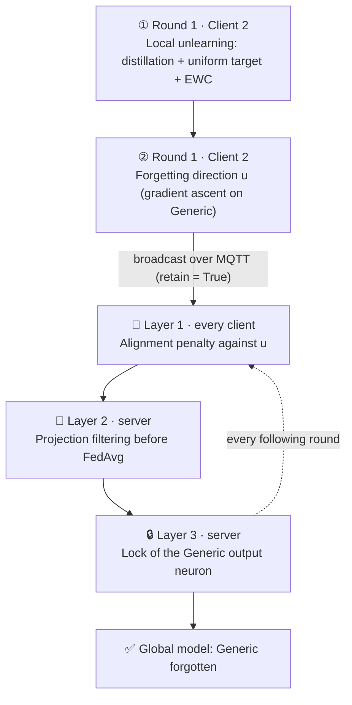
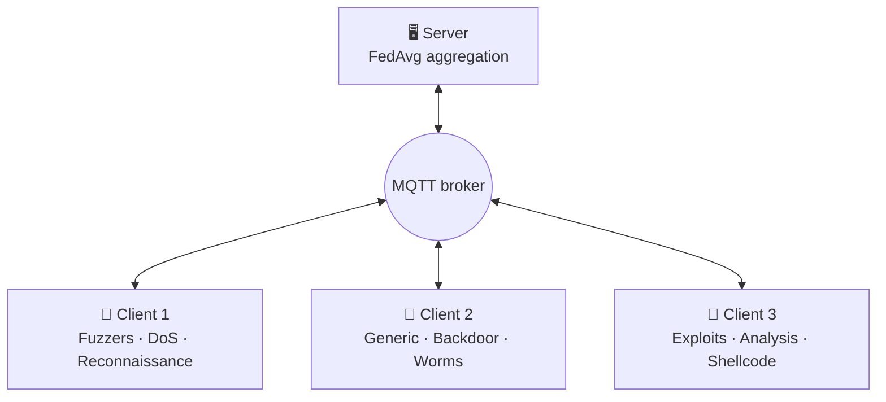

<div align="center">

# 🧠 FedAF-P: Federated Unlearning for IoT Intrusion Detection

**Making a federated IDS forget an attack class for good, across every client, without retraining from scratch.**


**Author:** Mohamed EL HARCHALI

</div>

---

## 📊 Results

<picture>
  <source media="(prefers-color-scheme: dark)" srcset="assets/results_dark.png">
  
</picture>

FL results after more than 300 rounds, then FedAF-P after fewer than 10 rounds (α = 0.30). Each client is evaluated on its own local test set.

| Client | Generic F1<br/>before → after | Normal F1<br/>before → after | Macro F1, 9 retained classes<br/>before → after | Accuracy<br/>before → after |
|---|---|---|---|---|
| **Client 1** | 0.773 → **0.000** ✅ | 0.720 → 0.717 | 0.294 → 0.277 | 0.569 → 0.421 |
| **Client 2** | 0.745 → **0.000** ✅ | 0.809 → 0.805 | 0.136 → 0.135 | 0.514 → 0.376 |
| **Client 3** | 0.648 → **0.000** ✅ | 0.758 → 0.761 | 0.199 → 0.192 | 0.488 → 0.382 |

### How to read these results

- ✅ **Forgetting is complete and persistent.** `Generic` precision, recall and F1 are all 0.000 on the 3 clients, on every round after unlearning.
- ✅ **Retained knowledge is almost intact.** On the 9 other classes, macro F1 moves by −0.002 to −0.018, and `Normal` stays stable (F1 ≈ 0.72–0.81).
- ℹ️ **The accuracy drop is expected.** `Generic` samples, which the model is now designed not to recognise, are counted as errors in the test sets.
- ℹ️ **Client 2's overall macro F1 drops from 0.197 to 0.121** because `Generic` made up 66% of its local data. Excluding the forgotten class, its macro F1 is unchanged (0.136 → 0.135).
- ⚠️ **Rare classes** (Analysis, Backdoor, Worms, Shellcode: under 1% of the data) stay close to zero both before and after. This is a pre-existing data-distribution problem, independent of unlearning.

### F1-score per class

| Class | Client 1<br/>before → after | Client 2<br/>before → after | Client 3<br/>before → after |
|---|---|---|---|
| Analysis | 0.000 → 0.000 | 0.000 → 0.000 | 0.055 → 0.040 |
| Backdoor | 0.000 → 0.000 | 0.039 → 0.040 | 0.000 → 0.000 |
| DoS | 0.278 → 0.254 | 0.015 → 0.014 | 0.012 → 0.015 |
| Exploits | 0.507 → 0.495 | 0.335 → 0.342 | 0.570 → 0.580 |
| Fuzzers | 0.337 → 0.235 | 0.009 → 0.003 | 0.189 → 0.192 |
| **Generic** 🎯 | 0.773 → **0.000** ✅ | 0.745 → **0.000** ✅ | 0.648 → **0.000** ✅ |
| Normal | 0.720 → 0.717 | 0.809 → 0.805 | 0.758 → 0.761 |
| Reconnaissance | 0.490 → 0.488 | 0.010 → 0.002 | 0.128 → 0.087 |
| Shellcode | 0.151 → 0.152 | 0.000 → 0.000 | 0.047 → 0.049 |
| Worms | 0.164 → 0.147 | 0.010 → 0.009 | 0.035 → 0.000 |
| **Macro F1** | 0.342 → 0.249 | 0.197 → 0.121 | 0.244 → 0.172 |

### Precision and recall after unlearning

These per-class details come from each client's local test set after FedAF-P.

| Class | Client 1<br/>precision | Client 1<br/>recall | Client 2<br/>precision | Client 2<br/>recall | Client 3<br/>precision | Client 3<br/>recall |
|---|---|---|---|---|---|---|
| Analysis | 0.000 | 0.000 | 0.000 | 0.000 | 0.020 | 0.894 |
| Backdoor | 0.000 | 0.000 | 0.020 | 0.930 | 0.000 | 0.000 |
| DoS | 0.154 | 0.727 | 0.025 | 0.009 | 0.240 | 0.008 |
| Exploits | 0.824 | 0.354 | 0.848 | 0.214 | 0.722 | 0.485 |
| Fuzzers | 0.145 | 0.624 | 0.002 | 0.003 | 0.252 | 0.154 |
| **Generic** 🎯 | 0.000 | 0.000 | 0.000 | 0.000 | 0.000 | 0.000 |
| Normal | 0.955 | 0.575 | 0.861 | 0.755 | 0.927 | 0.646 |
| Reconnaissance | 0.361 | 0.754 | 0.005 | 0.001 | 0.340 | 0.050 |
| Shellcode | 0.255 | 0.109 | 0.000 | 0.000 | 0.025 | 0.979 |
| Worms | 0.208 | 0.114 | 0.005 | 0.864 | 0.000 | 0.000 |

---

## 🛡️ FedAF-P: three layers of protection

FedAF-P combines a local unlearning step with three protection layers that stop the other clients from re-learning the forgotten class.

| Step | Where | Mechanism | Settings |
|---|---|---|---|
| ① **Local unlearning** | Client 2, round 1 | Distillation from a frozen teacher on the 9 retained classes + uniform target on `Generic` + EWC | EWC γ = 35, LR 3e-5, 3 epochs |
| ② **Forgetting direction** | Client 2 → all clients | Gradient ascent on `Generic` gives the direction `u` that would rebuild the class, broadcast over MQTT | `retain = True` |
| 🧲 **Layer 1: alignment penalty** | Every client | Brakes local updates aligned with `u` (cosine similarity) | λ = 0.15, −3% per round, floor 0.02 |
| 🧹 **Layer 2: projection filtering** | Server, before FedAvg | Removes the component of each update along `u`: `Δ − (Δ·u)u` | Every round |
| 🔒 **Layer 3: output-neuron lock** | Server, after FedAvg | Pulls the `Generic` output weights toward zero | α = 0.95, −8% every 3 rounds, floor 0.30 |



### Round 1: local unlearning on Client 2

Client 2 splits its data into a **retain** set (9 healthy classes) and an **unlearn** set (`Generic`). A frozen copy of the model acts as a teacher:

```text
L = KL(student ‖ teacher)   on retain data    → preserve the 9 other classes
  + KL(student ‖ uniform)   on Generic data   → maximum confusion (1 step out of 3)
  + (γ / 2) · Σ Fᵢ (θᵢ − θᵢ*)²                → EWC: freeze the important weights
```

Settings: EWC γ = 35, AdamW LR 3e-5, 3 epochs.

At the end of the round, Client 2 runs **gradient ascent on `Generic`** to find the direction `u` in which the network would rebuild the class. This direction is sent to the server and broadcast to every client.

### 🧲 Layer 1: alignment penalty (clients)

On every following round, each client **brakes its local update when it aligns with the forbidden direction** `u`, measured by cosine similarity.

> λ = 0.15 at the start, decaying by 3% per round, with a floor of λ_min = 0.02

### 🧹 Layer 2: aggregation filtering (server)

Before FedAvg, the server **removes from each client update its projection on the forbidden direction**. Only information orthogonal to `Generic` reaches the global model:

```text
Δ_clean = Δ − (Δ · u) u
```

### 🔒 Layer 3: output-neuron lock (server)

After each aggregation, the weight vector of the `Generic` class in the final layer is **interpolated towards zero**.

> α = 0.95 at the start, decaying by 8% every 3 rounds, with a floor of α_min = 0.30

---

## 📌 Table of Contents

- [The problem](#-the-problem)
- [Federated setup](#-federated-setup)
- [Dataset](#%EF%B8%8F-dataset)
- [Repository structure](#-repository-structure)
- [Getting started](#-getting-started)
- [Open issues & roadmap](#%EF%B8%8F-open-issues--roadmap)
- [References](#-references)

---

## 🎯 The problem

In **Federated Learning (FL)**, IoT clients train a shared intrusion-detection model without sharing their raw traffic. When a client asks for its data to be forgotten (GDPR *right to be forgotten*, poisoned data, a client leaving), retraining the global model from scratch is too expensive. **Federated Unlearning** removes that knowledge from the trained model instead.

Here, **Client 2 holds 100% of the `Generic` attack samples** and asks the federation to forget that class.

### Why local unlearning alone fails

A first approach made Client 2 erase `Generic` locally and send its update. But Clients 1 and 3 kept training normally. Their data contains no `Generic` samples, yet **their gradients were enough to rebuild the class patterns in the shared layers**:

> 📉 After one round, `Generic` recall climbed back to **~60%**. Unlearning carried by a single client does not hold in a federated system.

**FedAF-P** (*Federated Active Forgetting, Persistent*) solves this by turning forgetting into a constraint enforced on **every client and on the server**.

---

## 🌐 Federated setup



All clients also share one third of the `Normal` traffic. Each client simulates a specialised, heterogeneous IoT sensor (**non-IID**).

| Component | Details |
|---|---|
| **Model** | MLP `42 → 256 → 128 → 64 → 10`, BatchNorm1d, Dropout 0.3 |
| **Normalisation (FedNorm)** | Shared global scaler (mean / variance), computed once and sent to every client |
| **Local optimisation** | AdamW, LR 5e-4, weight decay 1e-4, batch 512, 3 epochs per round |
| **Drift control (FedProx)** | Proximal penalty μ = 0.1 between the local and global models |
| **Loss** | Focal loss γ = 2.0 with class weights 1/√N, to focus on rare attacks |
| **Aggregation** | FedAvg (arithmetic mean), communication over **MQTT** with pickle serialisation |
| **Training** | More than 300 rounds until convergence |

### Deployment: 1 server + 3 Linux VMs over MQTT

The system runs on **4 machines**: a central server that also hosts the **Mosquitto** broker, and **3 Linux virtual machines**, one per client. They only exchange model weights, scaler statistics and the forgetting direction, never raw traffic.

| Machine | Script | Role |
|---|---|---|
| Central server + broker | [`server/server_fedavg.py`](server/server_fedavg.py) | Phase 1: FedNorm + FedAvg, saves a checkpoint every round |
| Central server + broker | [`server/server_fedaf_p.py`](server/server_fedaf_p.py) | Phase 2: resumes the checkpoint, adds layer 2 (projection) and layer 3 (neuron lock) |
| VM 1 (`client_0`) and VM 3 (`client_2`) | [`clients/client.py`](clients/client.py) | FedProx + focal loss client |
| VM 2 (`client_1`) | [`clients/client_fedaf_p.py`](clients/client_fedaf_p.py) | Same client + local unlearning on its first round, forgetting direction `u`, layer 1 (alignment penalty) |

| MQTT topic | Direction | Payload |
|---|---|---|
| `client/scaler_stats/<id>` | client → server | Local mean / variance / sample count |
| `server/global_scaler` | server → clients | Federated scaler (retained) |
| `client/ready/<id>` | client → server | DataLoaders ready |
| `server/global` | server → clients | Global model weights, starts a round |
| `client/update/<id>` | client → server | Local weights + metrics (+ direction `u` on the unlearning round) |
| `server/unlearn_signal` | server → clients | Forgetting direction `u` (retained) |

---

## 🗂️ Dataset

[**UNSW-NB15**](https://research.unsw.edu.au/projects/unsw-nb15-dataset): 10 classes (`Normal` + 9 attack categories), 42 features after preprocessing.

| Class | Train | Train % | Test | Test % |
|---|---|---|---|---|
| Normal | 56,000 | 31.94% | 37,000 | 44.94% |
| **Generic** 🎯 | **40,000** | **22.81%** | **18,871** | **22.92%** |
| Exploits | 33,393 | 19.04% | 11,132 | 13.52% |
| Fuzzers | 18,184 | 10.37% | 6,062 | 7.36% |
| DoS | 12,264 | 6.99% | 4,089 | 4.97% |
| Reconnaissance | 10,491 | 5.98% | 3,496 | 4.25% |
| Analysis | 2,000 | 1.14% | 677 | 0.82% |
| Backdoor | 1,746 | 1.00% | 583 | 0.71% |
| Shellcode | 1,133 | 0.65% | 378 | 0.46% |
| Worms | 130 | 0.07% | 44 | 0.05% |

`Generic` is the largest attack class and the unlearning target.

### Non-IID partition

| Client | Local samples | Share of train | Attack classes | Generic share |
|---|---|---|---|---|
| Client 1 | 59,605 | 33.99% | Fuzzers · DoS · Reconnaissance | — |
| **Client 2** | **60,542** | **34.53%** | **Generic** · Backdoor · Worms | **66% of its data** |
| Client 3 | 55,194 | 31.48% | Exploits · Analysis · Shellcode | — |

Each client also receives about 18,666 `Normal` samples.

---

## 📁 Repository structure

```
.
├── server/
│   ├── server_fedavg.py                     # Phase 1: FedNorm + FedAvg over MQTT, checkpoint every round
│   └── server_fedaf_p.py                    # Phase 2: FedAvg + projection filtering + output-neuron lock
├── clients/
│   ├── client.py                            # FedProx + focal loss client (VM 1 and VM 3)
│   └── client_fedaf_p.py                    # Unlearning client (VM 2): distillation + EWC, direction u, alignment penalty
├── notebooks/
│   ├── prepro.ipynb                         # Data analysis + non-IID split (client train/test CSVs)
│   ├── pretraitement.ipynb                  # Earlier version of the preprocessing (train split only)
│   ├── Résultats_par_client_avant_FL.ipynb  # Local baseline of each client before federation
│   └── FedAF.ipynb                          # Standalone prototype of the local unlearning step (Colab)
├── data/README.md                           # Where to put the CSV files (not versioned)
├── assets/                                  # Result charts
├── .env.example                             # MQTT broker address
├── requirements.txt
└── README.md
```

> 📝 In the code and the notebooks, clients are numbered `client_0`, `client_1` and `client_2`. They match Clients 1, 2 and 3 in this README.

### About `FedAF.ipynb`

This notebook is a **standalone Colab prototype of the local unlearning step**, without MQTT or the following rounds. It starts from the converged global checkpoint and applies distillation + uniform target + EWC on the `Generic` client (EWC γ = 15, LR 5e-5, 4 epochs).

On its own, it already drives `Generic` recall from **0.99 to 0.03**. It was this experiment that showed local forgetting is not enough once federated training resumes, which motivated the three FedAF-P layers.

---

## 🚀 Getting started

### 1. Data and dependencies (every machine)

1. Download `UNSW_NB15_training-set.csv` and `UNSW_NB15_testing-set.csv` from the [official UNSW-NB15 page](https://research.unsw.edu.au/projects/unsw-nb15-dataset) into `data/`.
2. Install the dependencies:

   ```bash
   python3 -m venv env
   source env/bin/activate
   pip install -r requirements.txt
   ```

3. Run [`notebooks/prepro.ipynb`](notebooks/prepro.ipynb) to generate `client_{0,1,2}_train.csv`, `test_{0,1,2}.csv` and `global_test.csv`, then copy each VM's two files into its `data/` folder (see [`data/README.md`](data/README.md)).

### 2. MQTT broker (central server)

Install [Mosquitto](https://mosquitto.org/download/) and let it listen on the network, for example with this `mosquitto.conf` on an isolated lab network:

```text
listener 1883
allow_anonymous true
```

On every machine, point the scripts at the broker (default `localhost`, see [`.env.example`](.env.example)):

```bash
export MQTT_BROKER=<server-ip>
export MQTT_PORT=1883
```

### 3. Phase 1: federated training (FedAvg + FedProx)

Run every command from the repository root. Start the server first, then one client per VM:

```bash
# Central server
python3 server/server_fedavg.py

# VM 1, VM 2, VM 3
python3 clients/client.py 0 data/client_0_train.csv data/test_0.csv
python3 clients/client.py 1 data/client_1_train.csv data/test_1.csv
python3 clients/client.py 2 data/client_2_train.csv data/test_2.csv
```

The server waits for the 3 clients, builds the federated scaler, then runs the rounds. It saves `global_checkpoint.pth` and `federated_scaler.pkl` every round and resumes from them after a restart. Delete both files to start from scratch.

### 4. Phase 2: FedAF-P unlearning of `Generic`

Stop the processes once the model has converged (more than 300 rounds), then restart with the FedAF-P scripts. The server resumes the phase 1 checkpoint; VM 2 runs the local unlearning step on the first round it receives:

```bash
# Central server
python3 server/server_fedaf_p.py

# VM 2: the client that asks to forget Generic
python3 clients/client_fedaf_p.py 1 data/client_1_train.csv data/test_1.csv

# VM 1 and VM 3: unchanged
python3 clients/client.py 0 data/client_0_train.csv data/test_0.csv
python3 clients/client.py 2 data/client_2_train.csv data/test_2.csv
```

After the unlearning round the server also saves `unlearn_direction.pkl`, broadcasts `u` on `server/unlearn_signal` and applies layers 2 and 3 on every following round.

### 5. Notebooks

- [`notebooks/Résultats_par_client_avant_FL.ipynb`](notebooks/Résultats_par_client_avant_FL.ipynb) gives the local baselines.
- For [`notebooks/FedAF.ipynb`](notebooks/FedAF.ipynb), upload the global checkpoint (`global_checkpoint.pth`), the federated scaler (`federated_scaler.pkl`), `client_1_multiclass_train.csv` and `global_test_multiclass.csv` into the Colab session.

---

## 🛠️ Open issues & roadmap

- [ ] **Persist `pin_strength` across server restarts.** `rounds_since_unlearn` was reset to 0 on every restart, which kept the output-neuron lock at 95% instead of decaying to 30%. The fix is to save both values in the checkpoint and reload them.
- [ ] **Stabilise Client 2 after forgetting.** Its local model loses 66% of its data structure. A reduced learning rate (1e-5) for 5 rounds after unlearning would allow a gradual recovery.
- [ ] **Add server-side evaluation.** Metrics are currently computed by each client on its own test set. A neutral test set on the server would give the true health of the aggregated global model.
- [ ] **Improve rare classes** (Analysis, Backdoor, Worms, Shellcode), independently of unlearning.
- [ ] Compare with retraining from scratch without `Generic` (the gold standard), and add a membership-inference audit.

---

## 📚 References

- McMahan et al., *Communication-Efficient Learning of Deep Networks from Decentralized Data* (FedAvg), AISTATS 2017
- Li et al., *Federated Optimization in Heterogeneous Networks* (FedProx), MLSys 2020
- Kirkpatrick et al., *Overcoming catastrophic forgetting in neural networks* (EWC), PNAS 2017
- Hinton et al., *Distilling the Knowledge in a Neural Network*, 2015
- Lin et al., *Focal Loss for Dense Object Detection*, ICCV 2017
- Moustafa & Slay, *UNSW-NB15: a comprehensive data set for network intrusion detection systems*, MilCIS 2015
