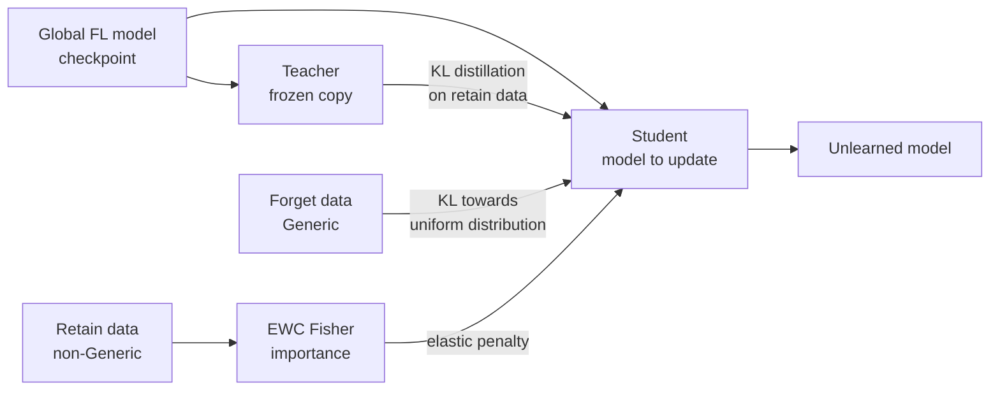

# 🧠 Federated Unlearning for Intrusion Detection (FedAF)

> Making a federated intrusion-detection model **forget** one client's attack class without retraining from scratch, using knowledge distillation and Elastic Weight Consolidation (EWC).

**Author:** Mohamed EL HARCHALI

---

## 📌 Table of Contents

- [Context](#-context)
- [Dataset & federated setup](#-dataset--federated-setup)
- [Method: FedAF (Active Forgetting)](#-method-fedaf-active-forgetting)
- [Results](#-results)
- [Repository structure](#-repository-structure)
- [Getting started](#-getting-started)
- [Limitations & next steps](#%EF%B8%8F-limitations--next-steps)

---

## 🎯 Context

In **Federated Learning (FL)**, several clients train a shared model without sharing their raw data. But what if a client leaves the federation, or asks for its data to be removed (*right to be forgotten*, GDPR)? Retraining the global model from scratch is expensive.

**Federated Unlearning (FU)** aims to remove the influence of specific data from an already-trained global model. This project applies it to a **network Intrusion Detection System (IDS)**: the goal is to make the global model forget the `Generic` attack class contributed by one client, while keeping its knowledge of the other classes.

---

## 🗂️ Dataset & federated setup

- **Dataset:** [UNSW-NB15](https://research.unsw.edu.au/projects/unsw-nb15-dataset), 10 classes (`Normal` + 9 attack categories)
- **Global train set:** 175,341 flows · **Global test set:** 82,332 flows
- **3 non-IID clients:** each client receives 3 attack categories plus one third of the `Normal` traffic

| Client | Attack classes | Local samples |
|---|---|---|
| Client 0 | Fuzzers, DoS, Reconnaissance (+ Normal) | 59,605 |
| Client 1 | **Generic**, Backdoor, Worms (+ Normal) | 60,542 |
| Client 2 | Exploits, Analysis, Shellcode (+ Normal) | 55,194 |

Each client also gets a matching local test set (`test_0.csv`, `test_1.csv`, `test_2.csv`). Rare classes are oversampled to 3,000 samples during local training.

### Local baselines (before federation)

Each client trains its own MLP on its local data only:

| Client | Accuracy | F1 weighted | F1 macro |
|---|---|---|---|
| Client 0 | 0.661 | 0.703 | 0.638 |
| Client 1 | 0.888 | 0.929 | 0.536 |
| Client 2 | 0.790 | 0.850 | 0.478 |

---

## ⚙️ Method: FedAF (Active Forgetting)

Starting from the converged global FL model, client 1 runs an unlearning procedure on its local data to forget the `Generic` class:



The student minimises a combined loss:

```
L = KL(student ‖ teacher)  on retain data      → keep what should be kept
  + KL(student ‖ uniform)  on forget data      → "blur" the Generic class
  + (γ / 2) · Σ F_i (θ_i − θ*_i)²              → EWC: protect important weights
```

| Hyper-parameter | Value |
|---|---|
| Epochs | 4 |
| Learning rate (AdamW) | 5e-5 |
| EWC strength γ | 15 |
| Distillation temperature T | 1.5 |
| Gradient clipping | 0.5 |

**Model:** MLP `input → 256 → 128 → 64 → 10` with BatchNorm, ReLU and Dropout(0.3).

---

## 📊 Results

Evaluation on the global multiclass validation set (32,313 flows, all 10 classes), before and after FedAF:

| Class | Recall before | Recall after | F1 before | F1 after |
|---|---|---|---|---|
| **Generic** (forgotten) | **0.99** | **0.03** ✅ | 0.99 | 0.07 |
| Normal | 0.99 | 0.98 | 0.95 | 0.98 |
| Exploits | 0.39 | 0.24 | 0.54 | 0.37 |
| DoS | 0.25 | 0.05 | 0.32 | 0.08 |
| Overall accuracy | 0.74 | 0.34 | | |

**Takeaways**

- ✅ **Forgetting works:** recall on `Generic` drops from 99% to 3%, so the model no longer recognises that class.
- ✅ **Normal traffic is preserved:** F1 on `Normal` even rises slightly (0.95 → 0.98).
- ⚠️ **Collateral damage:** other attack classes (DoS, Exploits, Reconnaissance) also degrade. The EWC penalty and the hyper-parameters still need tuning to isolate the forgetting better.

---

## 📁 Repository structure

```
.
├── prepro.ipynb                         # Data analysis + non-IID split into 3 clients (train & test CSVs)
├── pretraitement.ipynb                  # Earlier version of the preprocessing (train split only)
├── Résultats_par_client_avant_FL.ipynb  # Local baseline of each client before federation
├── FedAF.ipynb                          # Federated unlearning experiment (distillation + EWC)
├── requirements.txt
└── README.md
```

Recommended order: `prepro.ipynb` → `Résultats_par_client_avant_FL.ipynb` → *(federated training)* → `FedAF.ipynb`.

---

## 🚀 Getting started

The notebooks are designed for **Google Colab**.

1. Download `UNSW_NB15_training-set.csv` and `UNSW_NB15_testing-set.csv` from the [official UNSW-NB15 page](https://research.unsw.edu.au/projects/unsw-nb15-dataset).
2. Run `prepro.ipynb` to generate `client_{0,1,2}_train.csv`, `test_{0,1,2}.csv` and `global_test.csv`.
3. Run `Résultats_par_client_avant_FL.ipynb` for the local baselines.
4. For `FedAF.ipynb`, upload the global FL checkpoint (`global_checkpoint.pth`), the federated scaler (`federated_scaler.pkl`), `client_1_multiclass_train.csv` and `global_test_multiclass.csv` into the Colab session.

```bash
pip install -r requirements.txt
```

---

## ⚠️ Limitations & next steps

- The federated training that produces `global_checkpoint.pth` is not included in this repository.
- Datasets and model checkpoints are not versioned (size); they are regenerated from UNSW-NB15.
- [ ] Reduce collateral forgetting (per-class EWC, retain-set replay, tuning γ and T)
- [ ] Compare with retraining from scratch without client 1 (the gold standard)
- [ ] Add unlearning metrics: membership-inference attack, distance to the retrained model
- [ ] Extend to forgetting a whole client rather than one class

---

## 📚 References

- Moustafa & Slay, *UNSW-NB15: a comprehensive data set for network intrusion detection systems*, MilCIS 2015
- Kirkpatrick et al., *Overcoming catastrophic forgetting in neural networks* (EWC), PNAS 2017
- Hinton et al., *Distilling the Knowledge in a Neural Network*, 2015
